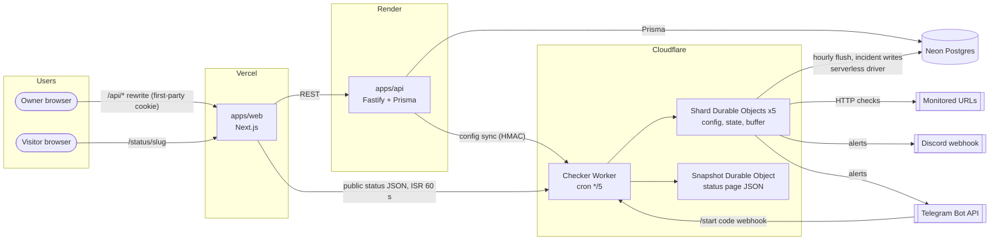
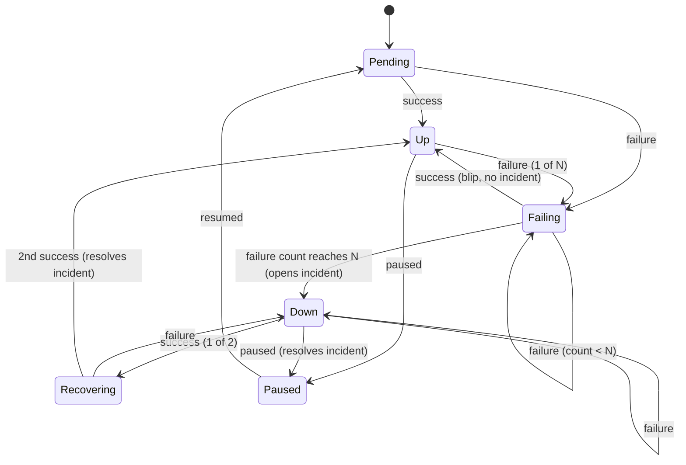

# Architecture

**Last updated:** 2026-10-29 · Related: [PRD](PRD.md), [ERD](ERD.md), [API contract](API.md), [Costs](COSTS.md), [ADRs](adr/)

## 1. Overview

Pulse has four deployable parts and one shared package:

| Part              | Runs on                                          | Job                                                                                                             |
| ----------------- | ------------------------------------------------ | --------------------------------------------------------------------------------------------------------------- |
| `apps/web`        | Vercel (Hobby)                                   | Next.js dashboard for signed-in users and public status pages                                                   |
| `apps/api`        | Render free web service (Docker image from GHCR) | Fastify + Prisma REST API: auth, projects, monitors, channels, history                                          |
| `apps/checker`    | Cloudflare Workers + Durable Objects (Free)      | Cron-driven checks, incident detection, alerts, hourly flush and rollups, live status and status-page snapshots |
| Postgres          | Neon (Free)                                      | Source of truth for accounts, config, history and incidents                                                     |
| `packages/shared` | Imported by all three apps                       | Types, zod schemas, the check/incident state machine, uptime maths                                              |

The design rule that shapes everything: **Neon must sleep most of the time** (100 CU-hours/month, see [COSTS.md](COSTS.md)), and **public pages must not wait for Render to wake up**.



## 2. Request paths

### Signed-in dashboard

1. The browser only talks to the Vercel domain. `next.config` rewrites `/api/*` to the Render API, so the refresh-token cookie is **first-party** (no third-party cookie problems in Safari or Chrome).
2. The API reads and writes Neon through Prisma. This wakes Neon, which is fine: a person is actively using the dashboard.
3. Current status on the dashboard comes from the checker's live endpoint (proxied by the API) so it is never more than one tick old, while history (latency charts, incidents) comes from Neon.
4. If Render is asleep the first request takes about a minute. The web app shows a "waking up the API" state after 3 s instead of an error.

### Public status page

1. `GET /status/<slug>` is a Next.js server component with ISR (`revalidate: 60`).
2. It fetches **one JSON document** from the checker: `GET /public/v1/status/<slug>`. That document merges the hourly snapshot (90-day bars, incidents) with each monitor's live state from the shards.
3. Neither the API nor Neon is on this path, so the page stays fast and available when Render is cold or Neon is asleep or out of compute.

**Decision (asked in the brief): status pages read neither Neon nor the API.** Reading Neon directly from Vercel server components would avoid Render cold starts, but every cache miss would wake Neon for at least 5 minutes, and a popular page could keep it awake all month. Snapshots built during the hourly flush cost one Neon wake per hour no matter how much traffic the pages get. See [ADR-0004](adr/0004-buffer-checks-in-durable-objects.md).

## 3. The checker

### 3.1 Scheduling

- One Cron Trigger per environment: `*/5 * * * *`.
- The cron Worker does almost nothing itself (it has only **10 ms of CPU**). It calls the 5 shard Durable Objects in parallel and returns.
- Each monitor is assigned a shard when it is created: `shard = hash(monitorId) mod 5`, stored in `monitors.shard`.
- Each shard holds at most **40 active monitors**, so a tick uses at most 40 of the 50 subrequests a Workers Free invocation allows, leaving 10 for Neon writes and alerts. 5 x 40 = the global cap of 200.
- Durable Objects get 30 s of CPU per invocation instead of 10 ms, and strongly consistent SQLite storage, which is why the work happens inside them.
- If a shard's previous tick is still running (it stores `tick_started_at`), the new tick is skipped and logged. A tick older than 4 minutes is considered dead and overridden.

Why a cron and not a queue: [ADR-0001](adr/0001-worker-cron-instead-of-a-queue.md).

### 3.2 Running a check

For each due monitor, 6 at a time (the simultaneous-connection limit):

1. `fetch(url, { method, headers, redirect: "follow", signal: AbortSignal.timeout(timeoutMs) })`.
2. Record `latency_ms` when the response headers arrive, then cancel the body without reading it (saves CPU, memory and DO duration).
3. Classify the result with `classifyCheck()` from `packages/shared`:
   - `ok`: status within the expected range.
   - `status`: got a response outside the range.
   - `timeout`, `dns`, `tls`, `connection`: no usable response.
4. Feed the result into the monitor's state machine (below) and append it to the tick's buffer.

The whole tick's results are written as **one SQLite row** (a JSON array) in the shard, not one row per check, to stay far below the 100,000 rows/day write limit.

### 3.3 Incident detection

The state machine lives in `packages/shared` as a pure function so it is unit-tested once and used by the checker:

```
nextState(state, result, threshold) -> { state, event? }
```



- **Open:** `N` consecutive failures (the monitor's threshold, default 3). The incident's `started_at` is the time of the **first** failure in the run, not the Nth, so durations are honest.
- **Resolve:** 2 consecutive successes. `resolved_at` is the time of the first success.
- **Pausing** a monitor that is down resolves its incident with reason `paused`.
- Per-monitor state (`status`, `consecutive_failures`, `consecutive_successes`, `first_failure_at`, `open_incident_id`) is stored in the shard's SQLite, so it survives restarts and needs no Neon read per tick.

With a 5-minute interval and threshold 3, an outage is detected 10 to 15 minutes after it starts (NFR-02).

### 3.4 Writing incidents and avoiding duplicate alerts

Incidents are rare, so they are written to Neon immediately instead of waiting for the hourly flush. Duplicate alerts are prevented at four layers:

1. **Single writer.** A Durable Object processes one tick at a time for its monitors, so two concurrent ticks can never both see "3rd failure" and open two incidents.
2. **Database constraint.** `incidents` has a partial unique index on `(monitor_id) WHERE resolved_at IS NULL`. Opening an incident is `INSERT ... ON CONFLICT DO NOTHING RETURNING id`; if nothing is returned, the incident already exists and no alert is queued.
3. **Outbox with an idempotency key.** For every incident event and every enabled channel, one row is inserted into `alert_deliveries` with a unique key `(incident_id, channel_id, event)` **before** anything is sent. The shard keeps an outbox; each tick it sends pending deliveries (within its spare subrequest budget), then marks them `sent`. A retry after a crash re-reads the same row, so the same event can't produce a second row. (A crash between Discord accepting the message and the `sent` update can still cause one repeat; this at-least-once window is accepted and documented.)
4. **Cooldown for flapping.** If a monitor's previous `opened` alert to the same channel was less than 10 minutes ago (configurable per channel), the new `opened` delivery is stored as `suppressed` instead of sent. `resolved` messages are sent only if the matching `opened` message was sent.

Delivery rules:

- Discord: respect `Retry-After` on 429; on 404 mark the channel `disabled` with reason `webhook_deleted`.
- Telegram: on 403 (bot blocked) mark the channel `disabled`; on 429 respect `retry_after`.
- Max 5 attempts with backoff (next tick, +5, +15, +30, +60 min), then `failed`. Failed deliveries are visible on the dashboard.

### 3.5 Hourly flush (minute 0 of every hour)

Each shard, on the tick at minute 0, after its checks:

1. Inserts all buffered results into `check_results` in one statement (`INSERT ... SELECT * FROM unnest(...)`), using `ON CONFLICT (monitor_id, checked_at) DO NOTHING` so a retried flush is safe.
2. Deletes the flushed buffer rows only after Neon confirms the insert.
3. Pulls its monitor config from Neon (`WHERE shard = $1`) to reconcile anything a missed sync dropped.

Then the cron Worker (one shard is elected by `hour mod 5`) runs the maintenance SQL in Neon:

1. Upsert `check_rollups_hourly` for the last 2 complete hours.
2. Upsert `check_rollups_daily` for today and yesterday (UTC).
3. Delete raw checks older than 7 days, hourly rollups older than 30 days, daily rollups and resolved incidents older than 400 days.
4. Build one status-page snapshot per public project (90 daily bars, 90-day uptime %, last 14 days of incidents) and store them in the Snapshot Durable Object.

All steps are idempotent upserts or range deletes, so a missed or repeated hour is harmless. Details: [ADR-0002](adr/0002-data-retention-and-rollups.md).

### 3.6 Keeping config in sync

Neon is the source of truth for monitor config; shards hold a copy.

- When the API creates, updates, pauses or deletes a monitor, it calls `POST /internal/v1/monitors/sync` on the checker with the monitor's config, signed with an HMAC-SHA256 shared secret and a timestamp (rejected if older than 5 minutes). The checker routes it to the right shard.
- If that call fails, the API still succeeds; the hourly reconcile (3.5 step 3) fixes it within the hour, and the dashboard shows "pending sync".

## 4. Multi-tenancy and data access

- Shared database, shared schema; every tenant-owned row is reachable from `projects.owner_id`. The API scopes every query by the authenticated user. See [ADR-0003](adr/0003-multi-tenancy.md).
- Two Postgres roles: `pulse_api` (full access to app tables, used by Prisma) and `pulse_checker` (insert into `check_results`, `incidents`, `alert_deliveries`; select on `monitors`, `alert_channels`, `projects`; rollup and delete on history tables). The checker never touches `users` or `refresh_tokens`.
- Alert secrets (Discord webhook URLs, Telegram chat ids) are encrypted with AES-256-GCM using a key that only the API and checker hold.

## 5. Environments

|          | Local                                       | Staging                            | Production                 |
| -------- | ------------------------------------------- | ---------------------------------- | -------------------------- |
| Web      | `next dev`                                  | Vercel preview deployments         | Vercel production          |
| API      | `tsx watch` against Docker Compose Postgres | Render service `pulse-api-staging` | Render service `pulse-api` |
| Checker  | `wrangler dev --test-scheduled`             | Worker env `staging`               | Worker env `production`    |
| Database | Docker Compose Postgres 17                  | Neon branch `staging`              | Neon branch `main`         |

Neon's serverless driver talks HTTP/WebSocket, not the Postgres wire protocol, so it can't reach a plain Postgres container. **Decision (Phase 1):** the checker's queries go through a small `CheckerDb` interface with two implementations, picked by the `DB_DRIVER` variable: `neon-http` (Neon's serverless driver, used in Cloudflare) and `pg` (node-postgres over TCP, which runs in workerd with `nodejs_compat`, used with `wrangler dev` and in integration tests against Docker Compose Postgres). Both share the same SQL, so tests cover the queries that run in production.

## 6. Failure modes

| Failure                  | Effect                                                   | Handling                                                                                                                                                                                                                           |
| ------------------------ | -------------------------------------------------------- | ---------------------------------------------------------------------------------------------------------------------------------------------------------------------------------------------------------------------------------- |
| Render API asleep        | Dashboard first load ~1 min                              | "Waking up" UI; status pages unaffected                                                                                                                                                                                            |
| Neon out of CU-hours     | No new history, no dashboard, incidents can't be written | Shards keep checking and keep buffering (up to 7 days of buffer fits easily in 1 GB); status pages show live state from shards plus the last snapshot; alerts still send from the shard state with an `incident_pending_db` marker |
| Neon cold start (~1 s)   | Slower flush                                             | Driver retry with backoff                                                                                                                                                                                                          |
| Checker tick overruns    | Skipped tick                                             | `tick_started_at` guard, logged to Sentry                                                                                                                                                                                          |
| Discord/Telegram down    | Alerts delayed                                           | Outbox retries for up to ~2 hours                                                                                                                                                                                                  |
| Missed config sync       | Up to 1 hour stale config                                | Hourly reconcile                                                                                                                                                                                                                   |
| Cloudflare cron incident | No checks                                                | Out of our control; documented. A future "watchdog" could check the last flush time from the API.                                                                                                                                  |

## 7. Why each part lives where it does

- **Checker on Cloudflare, not Render:** Render free has no background workers or cron, and a sleeping web service can't run checks.
- **API on Render, not Vercel functions:** the brief asks for a Dockerised API deployed through GHCR, which shows container CD. Vercel functions remain the fallback if Render needs a card.
- **Snapshots in a Durable Object, not KV:** Workers KV allows only 1,000 writes per day on the free plan and is eventually consistent; Durable Objects give 100,000 row writes per day and strong consistency.
