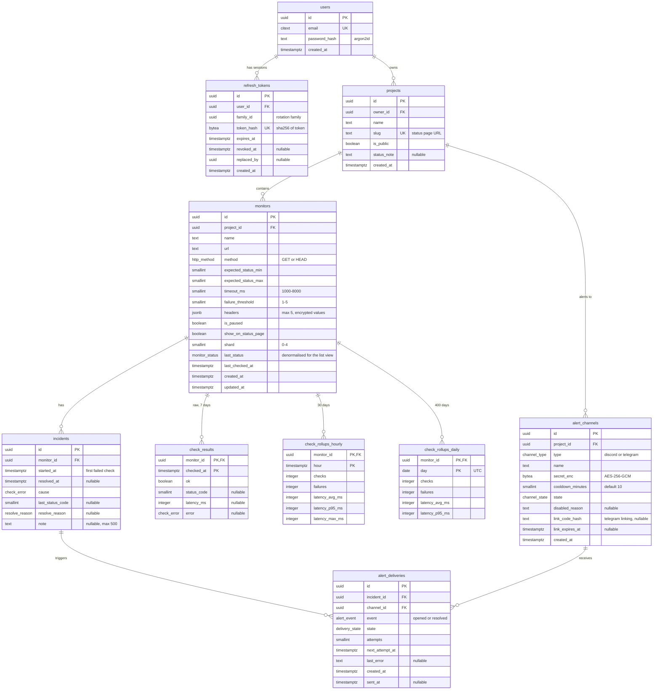

# Data model (ERD)

**Last updated:** 2026-10-29 · Database: Postgres 17 (Neon in the cloud, Docker Compose locally) · Schema owner: Prisma (`apps/api/prisma/schema.prisma`)

## Enums

| Enum | Values |
| --- | --- |
| `http_method` | `GET`, `HEAD` |
| `monitor_status` | `pending`, `up`, `failing`, `down`, `recovering`, `paused` |
| `check_error` | `status`, `timeout`, `dns`, `tls`, `connection` |
| `resolve_reason` | `recovered`, `paused`, `deleted` |
| `channel_type` | `discord`, `telegram` |
| `channel_state` | `pending_link` (Telegram before `/start`), `active`, `disabled` |
| `alert_event` | `opened`, `resolved` |
| `delivery_state` | `pending`, `sent`, `suppressed`, `failed` |

## Constraints and indexes

| Table | Constraint / index | Why |
| --- | --- | --- |
| `users` | unique `email` (`citext`) | Case-insensitive login |
| `refresh_tokens` | unique `token_hash`; index `(family_id)` | Lookup on refresh; revoke a whole family on reuse |
| `projects` | unique `slug`; index `(owner_id)` | Public URL; tenant scoping |
| `monitors` | index `(project_id)`; index `(shard) WHERE NOT is_paused` | Dashboard list; hourly reconcile per shard |
| `monitors` | check `expected_status_min <= expected_status_max`, `timeout_ms BETWEEN 1000 AND 8000`, `failure_threshold BETWEEN 1 AND 5` | Mirrors the zod schema |
| `check_results` | PK `(monitor_id, checked_at)` | Idempotent flush (`ON CONFLICT DO NOTHING`); range scans for charts |
| `check_rollups_*` | PK `(monitor_id, hour/day)` | Idempotent upserts |
| `incidents` | **unique `(monitor_id) WHERE resolved_at IS NULL`** | At most one open incident per monitor (duplicate-alert layer 2) |
| `incidents` | index `(monitor_id, started_at DESC)` | Incident history |
| `alert_deliveries` | **unique `(incident_id, channel_id, event)`** | Idempotency key for the outbox (layer 3) |
| `alert_deliveries` | index `(channel_id, event, sent_at DESC)` | Cooldown lookup (layer 4) |
| `alert_deliveries` | index `(state, next_attempt_at) WHERE state = 'pending'` | Retry scan |

All foreign keys from `monitors` downwards use `ON DELETE CASCADE`, so deleting a project or monitor removes its history (US-05). `users -> projects` also cascades, for account deletion.

## Notes

- **Caps** (3 projects, 10 monitors per user, 5 channels per project, 200 global) are enforced by the API in a transaction, not by the schema, because they are config values.
- **`monitors.last_status` / `last_checked_at`** are denormalised and updated at the hourly flush and on incident events. The dashboard shows the live value from the checker and falls back to these when the checker can't be reached.
- **Secrets:** `alert_channels.secret_enc` holds the Discord webhook URL or the Telegram chat id, encrypted. Custom request header values in `monitors.headers` are encrypted the same way, because they often contain API keys.
- **Not stored in Postgres:** per-monitor counters and the unflushed check buffer live in the shard Durable Objects' SQLite (see [ARCHITECTURE.md](ARCHITECTURE.md#33-incident-detection)). Postgres is still the source of truth for config and history.
- **Uptime %** is `1 - failures / checks` over the period, summed from rollups. A day with zero checks (monitor paused or added later) shows as "no data", not 100%.
- **Storage estimate** at the global cap: < 100 MB (see [COSTS.md](COSTS.md#storage-budget-1-gb)).
